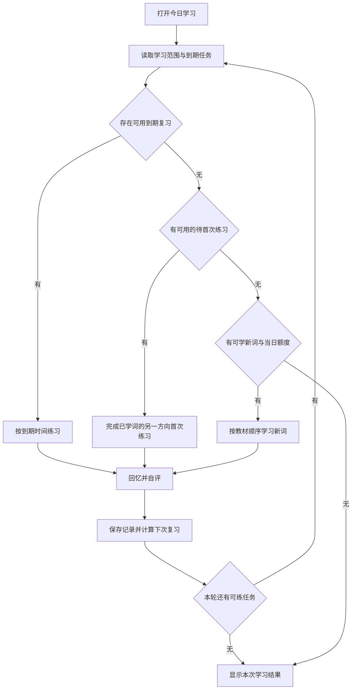

# 教材同步单词复习 PRD

版本：v0.1

日期：2026-10-25

状态：待评审
首批范围：北师大版小学英语三年级起点四至六年级，以及北师大版初中英语七至九年级。

# 产品目标与范围

面向小学四年级至初三学生，提供按教材选词、听读背诵和自动安排复习的个人学习工具。学生每天打开后能明确知道需要复习什么、学习什么，并在中断后继续。家长或内容维护者能导入其他教材词表、修正内容，并保留已有学习记录。

首版完成三个闭环：教材词表经过核对后入库；学生听音、跟读、回忆并反馈；系统根据每次反馈生成后续复习任务。

## 已确定的要求

| 事项     | 要求                                           |
| -------- | ---------------------------------------------- |
| 学习重点 | 单词读音、词义回忆和背诵                       |
| 复习方式 | 根据个人反馈自动安排间隔复习                   |
| 词库能力 | 方便收录不同教材、年级和分册                   |
| 首批教材 | 北师大版，小学采用三年级起点，覆盖四年级至初三 |
| 产品形态 | 网页版或 Windows App 均可                      |

## 本版采用的产品默认值

以下是用于收敛首版的方案选择，可在评审时调整。

- 采用 PWA 网页版，支持在 Windows 安装为独立窗口；按单人、本机使用设计。
- 使用成熟的 FSRS 间隔复习库，首版采用库的默认参数，目标保持率初始设为 90%。
- 每天默认学习 10 个新词，可调整为 0 至 100；到期复习优先。
- 默认同时练习看词回忆和听音回忆，两种练习分别记录掌握状态。
- 默认优先英音，可选择设备可用的英语音色；语速提供慢速、正常、快速三档。
- 学习数据保存在本机，提供完整备份和恢复。

首版范围包含教材选择、词表导入、示范发音、跟读、自评、间隔复习、断点恢复和基础统计。拼写听写、自动语音纠错、AI 生成内容、账号和跨设备同步、班级管理、游戏养成列入后续范围。

# 首批教材与内容准入

## 教材清单

| 学段和年级 | 分册                   | 当前候选册数 |
| ---------- | ---------------------- | ------------ |
| 小学四年级 | 上册、下册，三年级起点 | 2            |
| 小学五年级 | 上册、下册，三年级起点 | 2            |
| 小学六年级 | 上册、下册，三年级起点 | 2            |
| 初中七年级 | 上册、下册             | 2            |
| 初中八年级 | 上册、下册             | 2            |
| 初中九年级 | 当前候选为全一册       | 1            |
| 合计       | 覆盖四至九年级         | 11           |

初中的教材系列独立标识，不将小学的“三年级起点”机械套用到初中。当前候选文件按 11 册组织；如果最终确认的九年级版次分为上下册，教材清单调整为 12 册，年级覆盖要求保持不变。

## 数据来源与核对规则

候选基础词表来自 [lilinji/English 北师大目录](https://github.com/lilinji/English/tree/main/1.%E5%85%A8%E5%9B%BD%E5%90%84%E5%A4%A7%E6%95%99%E6%9D%90%E7%89%88%E6%9C%AC%E4%B8%AD%E5%B0%8F%E5%AD%A6%E5%90%8C%E6%AD%A5/%E5%8C%97%E5%B8%88%E5%A4%A7)。该目录中有上述分册文件，文件名本身不能证明其对应当前使用的版次。

每个教材包保存出版社、系列、起始年级、学段、年级、册次、版次、来源和核对状态。版次未知时明确标记“版次待核对”，不得自动标为最新版。内容状态采用“待核对”和“已核对”；用户导入的词表默认待核对。

首批正式内置包的准入要求如下：

1. 内容维护者对照目标教材版权页，确认系列、版次和册次。
2. 按教材词汇表核对单词、短语、课内释义和词序；同形多义词保留课内含义。
3. 按教材实际目录核对单元和词条归属。源文件缺少单元时放入“未分单元”，不得按数量均分并标称教材单元。
4. 未分单元的词表可以按整册学习；正式标为“教材同步”的内置包必须完成单元核对。
5. 每词至少有一条在目标 Windows 浏览器可正常播放的发音路径。相同拼写的不同读音允许配置各自音频。
6. 保存原始来源、整理版本及使用说明。公开分发教材词表或音频前，确认相应再分发权限；软件许可证与教材资料权限分别记录。

首批完整版本以清单内全部分册通过准入为验收条件。研发可先用一个分册验证学习闭环，其余分册仍属于首批交付范围。

# 用户与使用场景

| 使用者           | 场景                   | 需要得到的结果                     |
| ---------------- | ---------------------- | ---------------------------------- |
| 学生             | 每天打开应用           | 先完成到期复习，再学习当天新词     |
| 学生             | 课上学到某个单元       | 从对应教材单元开始，保持教材顺序   |
| 学生             | 昨天没学或学习中退出   | 保留记录，继续到期任务，不重新开始 |
| 家长或内容维护者 | 收录新教材或老师的词表 | 通过预览、字段映射和校验后导入     |
| 家长或内容维护者 | 修正内容、升级词表     | 看清差异，保留无关词条的复习进度   |

首版所有操作属于同一本机学习档案。“学生”和“内容维护者”表示使用场景，不引入账号或权限角色系统。

# 每日学习流程

首次使用先选择教材与单元、设置每天新词数，并完成一次语音试听。用户可以选择多个教材包作为学习范围。默认选中整册；有未核对信息时，在教材详情中显示状态。

每日任务按以下顺序取词：

1. 可用的到期复习卡片优先，按到期时间从早到晚排列。
2. 没有可用到期卡时，处理已学词另一个方向的待首次练习。这类任务跨日保留，不受当日新词额度限制。
3. 当前两类任务均无可练项时，在剩余新词额度内按教材、单元和词序引入新词。
4. 本轮答“忘记”产生的短期重学任务，达到到期时间后进入复习队列；未到期时可继续其他任务。
5. 发音失败的听音卡暂时从本轮可练任务中跳过，保留原状态和到期时间，分别统计为“暂不可练”。用户重试成功后重新入队，重新进入应用时也重新检测；一张失败卡不阻塞其他复习或新词。
6. 未到期任务不冒充到期任务。当前可练任务做完而稍后仍有重学，或仍有暂不可练任务时，分别显示下次时间或异常数量。

每次以 10 张已提交评分的卡片作为一个可休息的小段。到期卡片总量不因分段而减少；用户可随时结束，未完成部分保持原到期状态。中断一天或多天后，按实际间隔继续调度，不清空进度、不额外补发错过的新词额度。

教材选择控制新词引入范围；已经开始学习的卡片继续进入每日复习，即使学生后来切换了年级或单元。只有在教材管理中明确“暂停该教材复习”后，其复习卡和待首次练习任务才移出队列；暂停不改变到期时间，恢复时按实际时间继续。

# 听读背诵流程

## 新词学习

新词卡同时显示英文、音标、课内中文释义与教材位置。学生播放示范音、跟读，可以重播和调整语速，然后点击“开始回忆”。浏览、播放和点击下一步都不直接记为“记住”。

新词学习结束后，先进入看词回忆。第一次有效评分保存时，为看词卡建立调度状态，将该词计入今日新词，并创建该词的听音待首次练习任务。听音卡在首次实际评分时建立自己的调度状态；同一词的两个方向在有其他词可学时尽量穿插，任务不足时允许相邻出现。只有浏览、尚未产生评分的新词可以重新进入教学，不计入已学词或待首次练习数量。

## 两种回忆方式

| 练习方式 | 揭晓前                                   | 学生动作                       | 揭晓后                                         |
| -------- | ---------------------------------------- | ------------------------------ | ---------------------------------------------- |
| 看词回忆 | 只显示英文，不显示音标和释义，不自动播放 | 尝试读出单词并回忆词义         | 显示音标和课内释义，提供示范发音，学生对照跟读 |
| 听音回忆 | 播放英语音频，隐藏英文、音标和释义       | 跟读所听内容，并回忆单词和词义 | 显示完整词卡及示范发音，学生对照确认           |

学生点击“查看答案”后才可提交评分。听音卡在揭晓前的屏幕阅读器描述、按钮名称等辅助信息也不得泄露英文答案。仅播放音频或跟读不会自动提交评分。

## 自评标准

| 按钮     | 学生判断                                       | FSRS 反馈 |
| -------- | ---------------------------------------------- | --------- |
| 忘记     | 看答案才知道、意思想错，或明显读错且自己未察觉 | Again     |
| 费力想起 | 揭晓前基本正确，经过较长回想，或发音不够确定   | Hard      |
| 记得     | 揭晓前能正确回忆意思，并基本读对               | Good      |
| 很熟     | 揭晓前立即正确回忆，读音也确定                 | Easy      |

评价依据是揭晓答案之前的表现。跟着答案读对之后，不能把之前未回忆出的词改记为“记得”。四档按钮都显示简短说明，并支持键盘操作。

首版依靠学生自评，不自动判断发音准确率；统计中不展示“口语评分”或自动生成的发音达标结论。

## 发音规则与异常

- 每次只播放一个词；切换卡片、切换音色或退出学习时停止上一段音频。
- 教材包有适用的配套音频时优先播放，缺失时回退到已选择的英语语音。设备可用音色通过浏览器检测，缺少指定音色时说明实际回退的音色。
- 列出发音来源和英音或美音标识，支持试听、重播，以及 0.75 倍、1 倍、1.25 倍语速。原始素材不支持变速时保留正常播放并说明。
- 音频失败提供重试或选择其他可用英语音色。不能播放时，听音卡不能提交评分，也不改变到期时间；用户可返回其他可用任务。
- 离线读音依赖已缓存音频或设备可用的本地英语音色；远程语音不能标为离线可用。语音检测与试听结果要能够让用户识别当前是否可离线听读。

浏览器支持区分本地与远程语音，具体音色随设备而变化，依据 [Web Speech API 语音说明](https://developer.mozilla.org/en-US/docs/Web/API/SpeechSynthesisVoice/localService)实现能力检测。

# 科学复习规则

## 调度与学习记录

采用 [ts-fsrs](https://github.com/open-spaced-repetition/ts-fsrs) 的稳定发布版本，在实现时锁定依赖版本和对应 FSRS 模型。复习时传入当前卡片状态、真实提交时间和四档反馈，保存算法返回的新状态及复习日志。首版使用默认模型参数，不进行个人参数训练。

90% 为初始调度目标，用于控制预期保持率和复习负担，不代表已经测得学生有 90% 的记忆率。后续是否开放高级参数配置另行评估。

看词回忆与听音回忆使用独立调度状态：某个词看得懂、听不懂时，听音卡可以更频繁出现。听音卡答对不直接提升看词卡状态，反之亦然。不同教材包中的词条默认各自记录进度，避免仅按英文拼写合并不同课内含义。

## 计数与时间口径

| 名称     | 定义                                                                 |
| -------- | -------------------------------------------------------------------- |
| 今日新词 | 某教材词条第一次产生有效评分时计 1 个；同一天两个方向均评分仍计 1 个 |
| 已学词   | 至少产生过一次有效评分的教材词条数量                                 |
| 到期复习 | 所有未暂停教材中，到期时间不晚于当前时间的卡片数                     |
| 本次完成 | 本次会话中已保存的有效评分次数，同一卡重学可再次计数                 |

每天新词上限限制词条首次产生有效评分，不限制已学词的另一个方向首次练习。正常情况下先处理该词两个方向的首次练习，再引入后续新词；听音暂不可用时按暂不可练规则跳过，不阻塞后续新词。另一个方向尚未评分时保留为待完成任务。多个标签页首次评分同一新词时，同样要原子校验剩余新词额度。

学习日默认采用 Asia/Shanghai 的自然日，日志和到期时刻以统一时间戳保存。跨午夜只更新“今日”计数，不清空会话和历史记录。设备时间明显早于上一条学习记录时，提示校准时间，并避免把负间隔写入复习日志。

## 保存与恢复

- 一次评分的日志、卡片新状态和统计更新要么全部保存，要么全部失败；保存成功后再切下一张卡。
- 重复点击或同一任务被重复提交只能产生一次有效记录。不同标签页同时使用时，以已保存的最新状态为准，过期页面须刷新该卡后再评分。
- 保存失败保留当前答案与反馈选择，并提供重试，不显示“已完成”。
- 退出后恢复到最近已保存的位置。未评分卡片恢复时重新呈现题面；不推断为正确或错误。
- 提供撤销最近一次评分，恢复该卡上一次状态并重新计数；连续撤销、跨设备撤销不属于首版范围。撤销某词首次评分时，同时撤回由该次评分创建且尚未评分的听音首练任务，使该词重新成为未学词。按日志原本所属的学习日重算计数，跨午夜撤销不得误减今天的新词数。
- 应用升级不得重置卡片状态。复习数据保留模型与数据格式版本，升级需要进行兼容迁移。

# 教材词库导入流程

## 支持的输入

首版支持 XLSX、UTF-8 CSV、TSV，以及从表格粘贴文本。XLSX 允许选择工作表；每次导入归属一个教材分册，可以包含多个单元。原始 XLS、PDF、图片和网页自动抓取留待后续支持。

提供一个可下载的词表模板，也可将现有分册导出为保留稳定词条标识的 CSV，修改后重新导入。导入上限默认单文件 10 MB、单次 20000 行，超出时要求拆分，不截断后悄悄入库。

## 教材信息与词条字段

教材信息由用户选择现有分册或新建时填写：教材版本或出版社、系列、学段、年级、册次为必填；小学三年级起点为首批固定值，其他教材按实际填写。版次、ISBN、来源链接和来源说明可后补，未知版次标为待核对。

| 词条字段         | 要求               | 处理规则                                           |
| ---------------- | ------------------ | -------------------------------------------------- |
| 英文单词或短语   | 必填               | 保留短语、大小写和标点，不能只接受单个字母串       |
| 课内中文释义     | 必填               | 按本教材含义学习，不能用无关词义替换               |
| 词性             | 可选               | 用于区分含义，不自动推断                           |
| 音标             | 可选               | 缺失不阻止导入，显示为空而非伪造                   |
| 单元和单元内顺序 | 可选               | 缺失归入未分单元，默认保留原始行序                 |
| 发音资源         | 可选               | 记录来源；未提供时走语音能力检测与回退             |
| 例句             | 可选               | 无例句也可完成首版学习                             |
| 稳定词条标识     | 首次可选，更新推荐 | 首次导入生成并在导出模板保留，用于后续识别同一条目 |

## 导入步骤

1. 选择现有教材分册，或填写新教材信息。不同版次单独建包。
2. 读取文件或粘贴内容，识别表头；多工作表时先选表，默认首个非空工作表。
3. 映射英文、释义及其他字段，自动映射结果必须允许修改。粘贴时支持制表符分列。
4. 展示数据预览、教材归属、总行数，以及新增、重复、待更新、错误行数；按全部数据计算数量。
5. 用户修复错误后重新校验，也可以明确选择跳过哪些错误行。跳过的数量与原因列入结果，不得静默丢弃。
6. 确认导入后一次性提交。失败保持原词库和学习状态，并返回失败原因。
7. 展示成功新增、更新、跳过数量，提供可定位到原始行号的错误报告；用户可直接进入词库浏览或开始学习。

## 校验与更新规则

- 仅修剪字段两端空白并规范换行，不自动改写大小写、词形、连字符或中文释义。
- 英文或释义为空为错误；必填列重复映射、无法识别的工作表和不可读文件阻止提交。
- 同一教材内，英文、词性和课内释义均相同的行作为重复候选。预览中由用户确认合并；合并时保留各单元归属，学习卡不重复创建。相同拼写、不同含义保留为不同条目。
- 再次导入已有稳定标识的词条时，音标、例句、单元等辅助信息可更新，学习进度保留。英文或课内释义实质变化时，预览明确标记“替换内容并重新学习”，待用户确认后创建新内部条目、归档旧条目；旧卡移出复习队列，历史日志保留，原进度不套用到新内容。
- 导入用的稳定标识与内部条目标识分开：同一教材内，一个导入标识最多对应一条当前有效条目。实质内容更新后该导入标识指向新条目，旧条目保留归档关系；重复导入同一修正版应匹配当前条目，不再次新增。导出 CSV 使用导入标识，以支持后续反复更新。
- 无稳定标识时，仅对同教材内英文、词性、释义完全一致的条目进行匹配；无法确定的条目展示为新增，不模糊覆盖。
- 上传文件里没有出现的旧条目不自动删除。删除或归档操作独立进行；有学习记录的旧条目优先归档，历史记录保留。
- 不同教材或不同版次导入不会覆盖彼此的词表和进度。词包更新使用明确的内容版本，与学习数据版本分开。
- 导入内容按普通文本展示；公式不执行，宏不加载；可疑音频地址、脚本地址和无效资源按错误处理。

# 词库浏览与信息结构

教材列表支持按出版社或版本、学段、年级、册次和版次筛选。教材详情展示单元、词条数量、来源、核对状态和当前是否参与复习。词条列表支持英文及中文搜索，并可播放发音。

信息分为以下部分，具体存储结构由实现者决定：

| 信息     | 最小内容                                                                 |
| -------- | ------------------------------------------------------------------------ |
| 教材包   | 教材身份、版次、单元、来源、内容版本、核对状态、复习暂停状态             |
| 教材词条 | 内部标识、导入标识、归档关系、英文、课内释义、音标、音频、单元关系与词序 |
| 复习卡   | 教材词条、练习方向、调度状态、到期时间和模型版本                         |
| 复习日志 | 唯一提交标识、实际时间、反馈、前后状态和撤销信息                         |
| 本机设置 | 学习范围、每天新词数、音色、语速与学习日时区                             |

# 页面与反馈

| 页面       | 核心内容与动作                                                   |
| ---------- | ---------------------------------------------------------------- |
| 今日学习   | 待完成首次练习、到期卡片、新词额度；开始或继续学习               |
| 学习页     | 当前练习方向、题面、播放、揭晓、自评、保存失败重试和最近一次撤销 |
| 教材词库   | 选教材与单元、搜索词条、查看来源、暂停或恢复教材复习             |
| 导入页     | 文件选择、字段映射、校验、差异预览、提交结果                     |
| 设置与备份 | 新词数量、英语音色与试听、语速、导出备份和恢复                   |

没有教材时引导选内置教材或导入；没有到期任务、待完成首练、暂不可练任务，且无可引入新词时显示“当前无待学任务”。若还有未完成首次练习、稍后到期的短期重学或暂不可练任务，分别展示，不能宣称全部任务已清空。

学习结果展示本次评分次数、今日新增词数和剩余到期卡片；不以播放次数作为记住的词数，不将预测保持率展示成实测效果。

# 本机保存与备份

教材、复习状态和日志采用浏览器本地存储，建议 IndexedDB。固定发布地址，避免更换域名后用户误以为数据丢失；清除网站数据会移除本机档案，这一点在备份说明中明确提示。

完整备份使用带格式版本的 JSON，包含教材包、稳定词条标识、卡片、复习日志和设置。在线音频保存资源引用与来源信息，不把尚未下载的音频标为已备份；临时音频缓存可在恢复后重建。首版暂不接收用户上传的音频二进制包。

首版恢复采用整库恢复：先校验格式和标识关联，再预览备份时间、词条数和学习记录数；明确提示将替换当前档案。恢复前提供当前档案备份并要求确认。恢复写入失败时原档案保持不变；不自动合并两套学习历史。

应用壳和已下载的教材支持离线打开。离线时学习记录照常保存；听音功能以本地音色或已缓存音频的实际可用性为准。缺少发音资源时遵循听音卡不可评分规则。

# 实现约束与质量要求

建议使用 TypeScript、PWA、ts-fsrs 和 IndexedDB。具体前端框架由实现者选择；复用标准音频和语音 API。首版不依赖后台服务或第三方 AI 密钥，静态站点通过 HTTPS 或本机开发地址运行。Windows 的 PWA 安装方式依据 [Microsoft Edge 官方说明](https://learn.microsoft.com/microsoft-edge/progressive-web-apps/ux)。

- 基线验收环境为 Windows 11 上当前稳定版 Edge 与 Chrome；浏览器直接打开和已安装 PWA 均需验证。
- 以 5000 个词条的本机档案作为性能用例：本地数据可用后，今日任务列表在 2 秒内可操作，评分保存与切卡在 500 毫秒内完成；音频网络耗时另行计量。这些数值为验收目标。
- 支持键盘完成播放、揭晓和四档评分，焦点清晰；文字和按钮保证基本可读性，不能只用颜色表达对错或状态。
- 词表导入、备份恢复和页面预览都不执行用户提供的脚本。学习过程与词表默认不上传外部服务器；使用远程音频或语音时明确外部请求用途。
- 固定时钟和已知卡片状态可用于验证算法接入，避免靠真实等待数天验证调度。

# 验收标准

以下均为首版必要条件，范围中的“指定教材”以确认后的教材清单为准。

| 编号 | 场景                | 通过标准                                                                                                               |
| ---- | ------------------- | ---------------------------------------------------------------------------------------------------------------------- |
| A01  | 首批教材            | 四至九年级所有指定分册可选；小学全部为三年级起点，版次、单元、词序和核对状态符合准入规则                               |
| A02  | 初始设置            | 完成选教材、每日新词设置和音色试听后，可直接进入学习                                                                   |
| A03  | 看词回忆            | 揭晓前不显示音标或释义、不自动读答案；揭晓后可听示范并评分                                                             |
| A04  | 听音回忆            | 揭晓前不通过可见或辅助文本泄露答案；音频失效时可重试且不能提交评分                                                     |
| A05  | 独立调度            | 同一词看词卡选“记得”、听音卡选“忘记”，两卡分别保存状态，互不冒充已掌握                                                 |
| A06  | FSRS 接入           | 对相同卡片、时间和反馈，应用结果与锁定版本库的结果一致；四档反馈映射正确                                               |
| A07  | 每日任务            | 到期优先；新词额度按词条去重计数；漏学一天不补发新词额度、不重置进度                                                   |
| A08  | 首次练习与切换教材  | 新词额度用完或跨日后仍能完成另一方向首练；听音失败不卡住其他任务；切换教材不丢弃复习，明确暂停后才移出队列             |
| A09  | 断点与保存失败      | 已保存记录在刷新后保留；未评分卡不被计分；模拟保存失败不切卡，重试不产生重复日志                                       |
| A10  | 重复提交与撤销      | 双击及两个标签页不产生重复评分或超额新词；撤销首次评分可撤回未评分的关联任务，并按原学习日恢复计数                     |
| A11  | 跨午夜              | Asia/Shanghai 跨日后今日计数正确变化，历史与未完成队列保留                                                             |
| A12  | 导入正常词表        | XLSX、CSV、TSV、粘贴词表均可映射和预览，提交后新增数与实际入库数一致                                                   |
| A13  | 导入异常与重复      | 空字段显示原行号；错误行需修复或明确跳过；重复项和同形多义词按规定处理，无静默丢词                                     |
| A14  | 单元缺失            | 缺少单元的文件归入未分单元，不生成假单元；可以整册学习                                                                 |
| A15  | 更新与导入失败      | 辅助信息更新保留进度；实质内容更新归档旧卡并重新学习，重复导入修正版不再新增；不同版次互不覆盖；中途失败不留下半份数据 |
| A16  | 备份恢复            | 导出后恢复，教材标识、卡片状态、日志、到期时间和设置一致；无效备份不修改当前档案                                       |
| A17  | 离线与 Windows 安装 | 缓存后可离线打开并保存反馈；可用本地发音正常播放，不可用时说明限制；Edge 可安装为独立窗口                              |
| A18  | 可操作性与性能      | 键盘可完成核心流程，5000 词档案满足设定的响应目标                                                                      |

# 待确认事项与交付顺序

当前需确认的是首批教材的具体版次或 ISBN，以及九年级实际为全一册还是上下册。小学三年级起点和四至九年级覆盖已确定，不再作为待选方案。

版次信息未齐时，先实现通用导入、学习和调度，并用标注清楚的候选词包验证；正式内置词包的准入与完整内容验收等待版次核对。英音优先、每日 10 个新词、单人本机和双方向独立调度按本版默认值推进。

交付顺序如下：

1. 用一个明确标注版次的教材分册，完成导入、两种回忆、自评、调度、保存与恢复。
2. 完成全部指定分册的内容核对和内置包制作，补齐导入差异处理、备份恢复及异常状态。
3. 验证 Windows 安装、离线能力、跨日和数据升级，并按 A01 至 A18 验收首版。

评审本 PRD 后，再据此拆分开发任务与实现计划。

# 参考资料

- [ts-fsrs 算法与接口](https://github.com/open-spaced-repetition/ts-fsrs/blob/main/packages/fsrs/README.md)：用于复习调度，实际接入以锁定版本的文档为准。
- [lilinji English 教材词库](https://github.com/lilinji/English)：首批北师大分册候选来源。
- [DictionaryData 数据结构](https://github.com/LinXueyuanStdio/DictionaryData)：参考教材身份、单元关系和词序组织，不以其旧版元数据替代目标教材核对。
- [TypeWords](https://github.com/zyronon/TypeWords)：参考学习交互与 FSRS 接入方式。
- [Microsoft Edge PWA](https://learn.microsoft.com/microsoft-edge/progressive-web-apps/ux)：Windows 安装能力。
- [浏览器语音能力](https://developer.mozilla.org/en-US/docs/Web/API/SpeechSynthesisVoice/localService)：本地与远程语音的区别。
